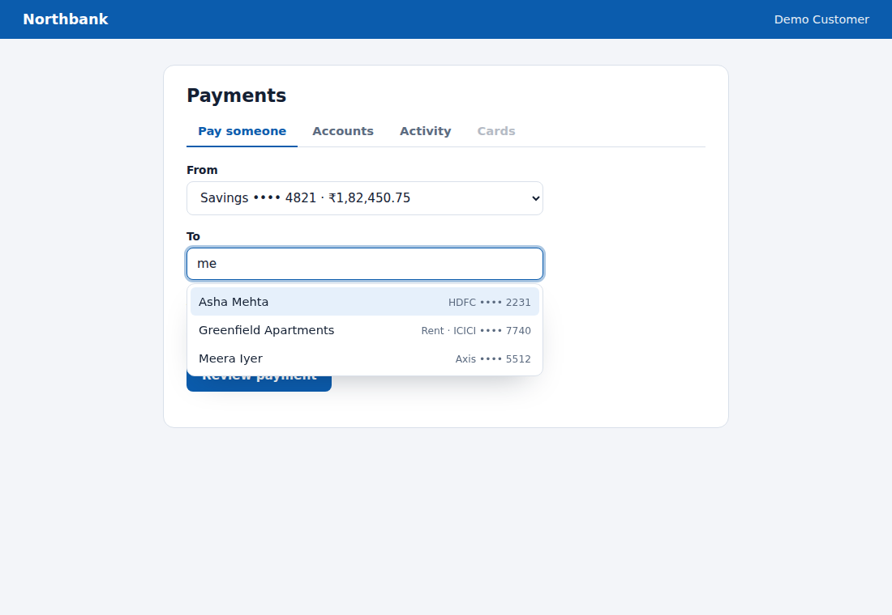
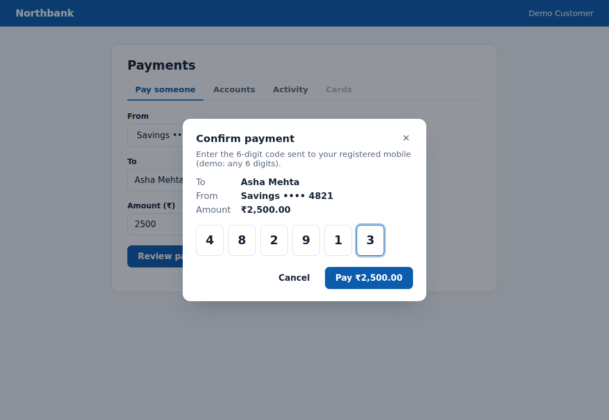
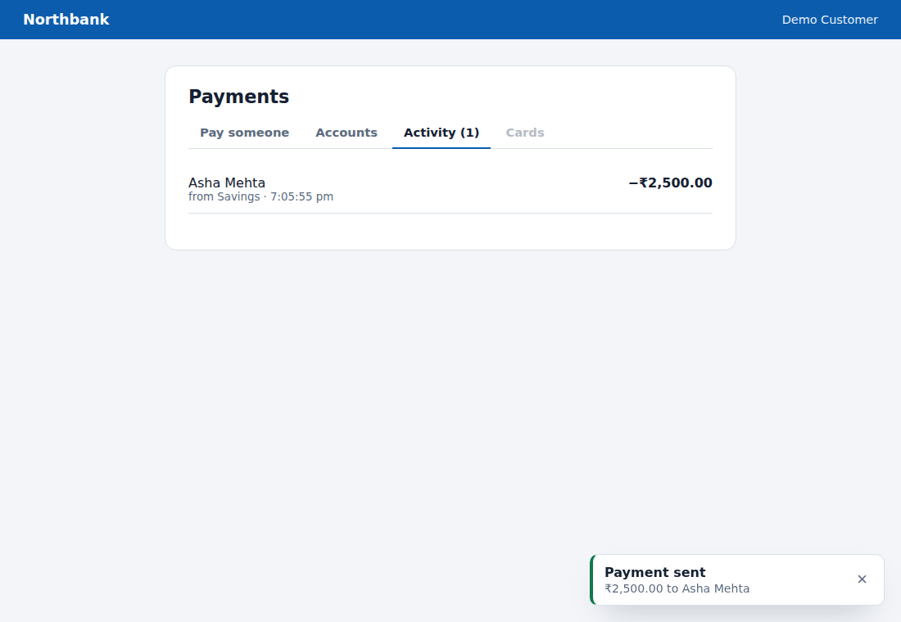

# northbank-ui

Accessible React components for banking apps: the interaction patterns every product team rebuilds
(tabs, autocomplete, modal confirmation, one-time codes, notifications) built once to WAI-ARIA standards,
themed with CSS tokens, and tested with Testing Library.



| Payment confirmation: Dialog + OtpInput | Activity tab + success Toast |
|---|---|
|  |  |

## Demo app
`playground/` is a small Northbank "Pay someone" flow built only from these components: search a payee,
enter an amount, confirm with a one-time code, get a toast, see the payment in Activity.

```bash
npm install
npm run dev        # http://localhost:5173
```

## Components

| Component | What it handles |
|---|---|
| `Tabs` | Roving tabindex, Arrow/Home/End keys, disabled tabs skipped, tab ↔ panel linking |
| `Combobox` | Debounced async search, **stale-response protection**, `aria-activedescendant`, Escape, mouse + keyboard selection |
| `Dialog` | Native `<dialog>` with `showModal()` (inert page, focus contained), Escape, backdrop click, **focus returns to the opener** |
| `OtpInput` | Auto-advance, backspace to previous, arrow keys, **paste the whole code**, `autocomplete="one-time-code"` |
| `ToastProvider` / `useToast` | Persistent `aria-live` region, auto-dismiss that **pauses on hover and focus** |
| `Button` | Variants, loading state with `aria-busy`, `type="button"` by default |
| `useDebouncedValue`, `debounce` | Shared utilities |

```tsx
import { Combobox, Dialog, OtpInput, ToastProvider, useToast } from '@satyajeet10/northbank-ui';
import '@satyajeet10/northbank-ui/styles.css';
```

## Theming
Every color, radius, and shadow is a `--nb-*` custom property in `src/styles.css`. Override them on `:root`
(or any container) to rebrand without touching component code.

## Quality
```bash
npm test          # 20 tests: keyboard behavior, ARIA wiring, race conditions, focus management
npm run typecheck
```
The demo flow is also verified end-to-end in a real browser: validation, payee search, OTP paste,
confirmation, toast, and focus returning to "Review payment" after the dialog closes.
